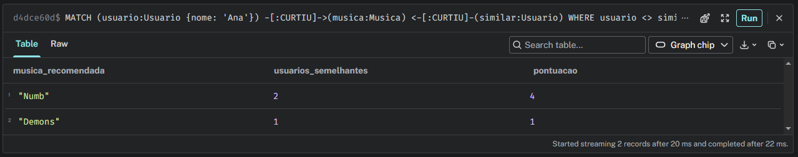
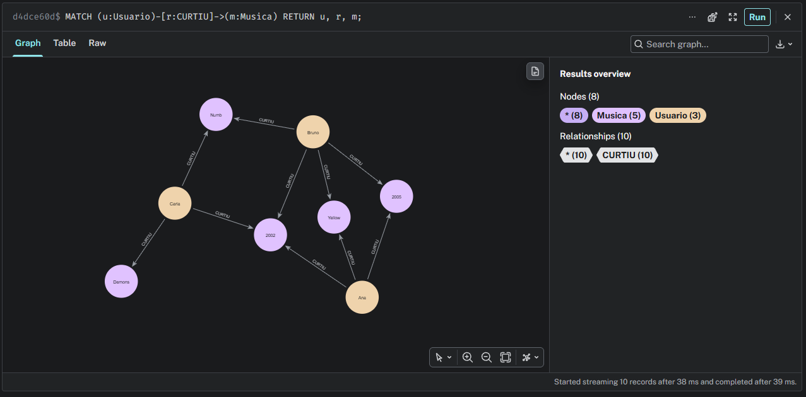
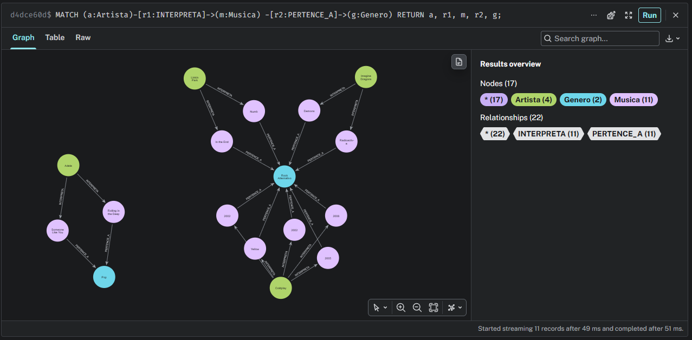

# 🎵 MusicGraph — Sistema de Recomendação Musical com Neo4j

## 📌 Sobre o projeto

O **MusicGraph** é um sistema de recomendação musical desenvolvido como parte do desafio **Criando um Algoritmo de Recomendação de Músicas com Base em Grafos**, da Digital Innovation One (DIO).

O projeto utiliza o banco de dados orientado a grafos **Neo4j** para representar usuários, artistas, músicas, gêneros musicais e suas conexões.

O objetivo é recomendar músicas com base nas preferências compartilhadas entre usuários, utilizando um algoritmo de **filtragem colaborativa**.

## 🛠️ Tecnologias utilizadas

- Neo4j AuraDB Free
- Linguagem Cypher
- CSV para armazenamento do dataset
- Visual Studio Code
- Git e GitHub
- Markdown para documentação

## 🧩 Modelagem do grafo

O banco de dados utiliza quatro tipos de nós:

| Nó | Descrição |
|---|---|
| Usuario | Representa um usuário do sistema |
| Artista | Representa um artista musical |
| Musica | Representa uma música |
| Genero | Representa um gênero musical |

Os relacionamentos são:

| Relacionamento | Descrição |
|---|---|
| CURTIU | Conecta usuários às músicas favoritas |
| INTERPRETA | Conecta artistas às músicas |
| PERTENCE_A | Conecta músicas aos gêneros musicais |

A modelagem completa está disponível em [docs/modelo_grafo.md](docs/modelo_grafo.md).

## 📊 Dataset

O projeto utiliza dados fictícios para fins educacionais.

| Elemento | Quantidade |
|---|---:|
| Usuários | 3 |
| Artistas | 4 |
| Músicas | 11 |
| Gêneros | 2 |
| **Total de nós** | **20** |
| **Total de relacionamentos** | **32** |

Os arquivos CSV estão disponíveis na pasta `dataset/`.

## 🧠 Algoritmo de recomendação

O MusicGraph utiliza filtragem colaborativa baseada em usuários.

O algoritmo:

1. Identifica usuários com músicas curtidas em comum.
2. Calcula a quantidade de preferências compartilhadas.
3. Identifica músicas curtidas por usuários semelhantes.
4. Exclui músicas que o usuário-alvo já curtiu.
5. Ordena as recomendações por pontuação.

A pontuação de uma música recomendada corresponde à soma das quantidades de músicas em comum com cada usuário semelhante que curtiu aquela música.

O algoritmo está disponível em `cypher/04_recomendacao_colaborativa.cypher`.

## 🎯 Resultados das recomendações

As consultas foram executadas e validadas no Neo4j AuraDB.

| Usuário | Música recomendada | Pontuação |
|---|---|---:|
| Ana | Numb | 4 |
| Ana | Demons | 1 |
| Bruno | Demons | 1 |
| Carla | Fix You | 3 |
| Carla | Yellow | 3 |

### Evidência — Recomendações para Ana



## 🔎 Análises musicais

As consultas de análise permitiram identificar:

- **Música mais popular:** Clocks, com 3 curtidas.
- **Artista mais popular:** Coldplay, com 7 curtidas.
- **Gênero mais curtido:** Rock Alternativo, com 10 curtidas.
- **Usuário com mais preferências:** Bruno, com 4 músicas curtidas.

As consultas estão disponíveis em `cypher/05_analises_musicais.cypher`.

## 🕸️ Visualizações do grafo

### Preferências musicais dos usuários



### Catálogo musical — Artistas, músicas e gêneros



## 🚀 Como executar o projeto

### 1. Preparar o Neo4j

Crie uma instância no Neo4j AuraDB ou utilize uma instalação local do Neo4j.

Abra o editor de consultas Cypher.

### 2. Criar a estrutura do banco

Execute as instruções do arquivo:

`cypher/01_estrutura.cypher`

Esse script cria restrições de unicidade para os nós.

### 3. Carregar o catálogo musical

Execute:

`cypher/02_catalogo_musical.cypher`

Esse script cadastra os artistas, as músicas, os gêneros e seus relacionamentos.

### 4. Cadastrar usuários e preferências

Execute:

`cypher/03_usuarios_preferencias.cypher`

Esse script cadastra os usuários e os relacionamentos `CURTIU`.

### 5. Executar o algoritmo

Execute:

`cypher/04_recomendacao_colaborativa.cypher`

Altere o nome do usuário na consulta para testar recomendações personalizadas.

### 6. Executar análises

Utilize as consultas disponíveis em:

`cypher/05_analises_musicais.cypher`

Execute cada instrução Cypher separadamente, conforme o editor utilizado.

## 📁 Estrutura do projeto

```text
dio-musicgraph-neo4j/
├── cypher/
│   ├── 01_estrutura.cypher
│   ├── 02_catalogo_musical.cypher
│   ├── 03_usuarios_preferencias.cypher
│   ├── 04_recomendacao_colaborativa.cypher
│   └── 05_analises_musicais.cypher
├── dataset/
│   ├── artistas.csv
│   ├── generos.csv
│   ├── musicas.csv
│   ├── preferencias.csv
│   └── usuarios.csv
├── docs/
│   ├── imagens/
│   │   ├── 01_grafo_preferencias.png
│   │   ├── 02_grafo_catalogo_musical.png
│   │   └── 03_recomendacoes_ana.png
│   └── modelo_grafo.md
└── README.md
```

## ⚠️ Limitações e melhorias futuras

O projeto utiliza um conjunto reduzido de dados fictícios e possui algumas limitações:

- Recomendações dependem de preferências compartilhadas entre usuários.
- Usuários sem histórico de curtidas podem não receber recomendações.
- O catálogo possui poucos gêneros e artistas.
- As músicas são identificadas pelo título, o que pode causar conflitos em catálogos maiores.

Como melhorias futuras, seria possível implementar identificadores únicos para músicas, ampliar o dataset, adicionar avaliações e combinar filtragem colaborativa com recomendações baseadas em gêneros.

## 📚 Conclusão

O MusicGraph demonstra como bancos de dados orientados a grafos podem ser utilizados para desenvolver sistemas de recomendação.

Com Neo4j e Cypher, foi possível modelar conexões entre usuários e músicas, identificar preferências compartilhadas e gerar recomendações personalizadas.

O projeto também apresenta consultas analíticas e visualizações que facilitam a compreensão das relações existentes no grafo.

---

**Projeto desenvolvido para fins educacionais — Desafio DIO.**